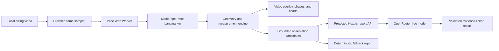

# Golf Swing Analyser

Golf Swing Analyser is an AI-assisted web application that helps golfers review a recorded face-on swing. It processes a video locally in the browser, overlays pose tracking on playback, derives movement and timing measurements, and produces a grounded natural-language report linked back to the supporting evidence.

The project is being built as a production-quality portfolio application, with an emphasis on maintainable architecture, honest computer-vision limitations, automated testing, accessibility, privacy, and deployment.

## Planned experience

- Upload a short face-on golf-swing video.
- Process the video locally with MediaPipe Pose Landmarker.
- Review synchronized skeleton and hand-path overlays.
- Mark address, top, impact, and finish positions.
- Inspect tempo, phase timing, body movement, and joint measurements.
- Generate an evidence-led AI report through OpenRouter.
- Follow each written observation back to its supporting phase, chart, or measurement.

The MVP will not claim to measure clubhead speed, ball flight, or overall swing quality. Those require club-specific tracking, calibration, and validation beyond body-pose estimation.

## System design



Video frames and raw pose landmarks remain in the browser. Only a reduced set of anonymous measurements, phase timings, and confidence information is sent to the report API. The language model selects and explains precomputed observation candidates; it does not invent or modify the underlying evidence.

## Planned technology

- Next.js, React, and strict TypeScript
- Tailwind CSS
- MediaPipe Pose Landmarker
- Web Workers and Canvas
- Recharts
- OpenRouter
- Redis-compatible quota and cache storage
- Vitest, Testing Library, and Playwright
- GitHub Actions and Vercel

## Project status

Implementation is in progress. The current foundation includes:

- A responsive Next.js application shell.
- A browser upload flow that produces a bounded, timestamped pose sequence.
- MediaPipe inference isolated in a Web Worker.
- Determinate processing progress with cancellation, retry, and resource cleanup.
- Synchronized video playback with Canvas skeleton, hand-path, and body-line overlays.
- Manual address, top, impact, and finish markers with tempo and image-space measurements.
- A server-owned observation engine that converts reduced measurements into ranked, evidence-linked candidates.
- A constrained OpenRouter adapter with structured output, claim validation, and a matching deterministic fallback.
- Twelve fixed report-evaluation scenarios covering tracking gaps, handedness, optional phases, and dominant movement categories.
- Explicit report consent, evidence-linked written insights, local feedback, and responsive report states.
- Atomic five-per-customer and 45-global daily AI limits with cached responses through Upstash Redis.
- Strict TypeScript, ESLint, Prettier, Vitest, and Playwright quality gates.

The full approved plan is available in [docs/implementation-plan.md](docs/implementation-plan.md).

## Local development

Requirements: Node.js 22.12 or later and npm 11 or later.

```bash
npm install
cp .env.example .env.local
npm run dev
```

The application works without an OpenRouter key by returning its deterministic report. Add `OPENROUTER_API_KEY` to `.env.local` to exercise live AI generation; the key is read only by the server route.

Production AI generation also requires `UPSTASH_REDIS_REST_URL`, `UPSTASH_REDIS_REST_TOKEN`, and a private `QUOTA_HMAC_SECRET`. Without quota storage, the application deliberately uses the deterministic report rather than making an unmetered model request.

Run the quality gates with:

```bash
npm run format:check
npm run lint
npm run typecheck
npm run test:run
npm run test:e2e
npm run build
```

## Documentation

- [Implementation plan](docs/implementation-plan.md)
- [Day 1 technical validation](docs/day-1-validation.md)
- [Day 2 production pose pipeline](docs/day-2-production-pipeline.md)
- [Day 3 review and measurement workspace](docs/day-3-review-and-measurements.md)
- [Day 4 grounded AI report pipeline](docs/day-4-grounded-ai-reports.md)
- [Day 5 report experience and quotas](docs/day-5-report-experience.md)
- [ADR 001: server-owned evidence boundary](docs/adr/001-server-owned-report-evidence.md)

## License

No license has been selected yet. All rights are reserved until a license is added.
