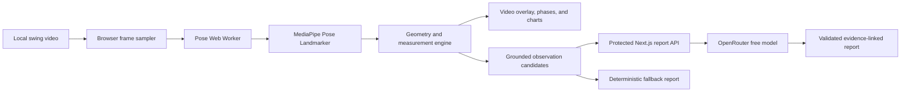

# Golf Swing Analyser

Golf Swing Analyser is an AI-assisted web application that helps golfers review a recorded face-on swing. It processes a video locally in the browser, overlays pose tracking on playback, derives movement and timing measurements, and produces a grounded natural-language report linked back to the supporting evidence.

The project is being built as a production-quality portfolio application, with an emphasis on maintainable architecture, honest computer-vision limitations, automated testing, accessibility, privacy, and deployment.

## Planned experience

- Upload a short face-on golf-swing video.
- Process the video locally with MediaPipe Pose Landmarker.
- Review synchronized skeleton and hand-path overlays.
- Mark address, top, impact, and finish positions.
- Inspect tempo, phase timing, body movement, and joint measurements.
- Generate an evidence-led AI report through OpenRouter.
- Follow each written observation back to its supporting phase, chart, or measurement.

The MVP will not claim to measure clubhead speed, ball flight, or overall swing quality. Those require club-specific tracking, calibration, and validation beyond body-pose estimation.

## System design

Video frames and raw pose landmarks remain in the browser. Only a reduced set of anonymous measurements, phase timings, and confidence information is sent to the report API. The language model selects and explains precomputed observation candidates; it does not invent or modify the underlying evidence.

## Planned technology

- Next.js, React, and strict TypeScript
- Tailwind CSS
- MediaPipe Pose Landmarker
- Web Workers and Canvas
- Recharts
- OpenRouter
- Redis-compatible quota and cache storage
- Vitest, Testing Library, and Playwright
- GitHub Actions and Vercel

## Project status

Planning is complete and implementation has not yet started. The full approved plan is available in [docs/implementation-plan.md](docs/implementation-plan.md).

## Documentation

- [Implementation plan](docs/implementation-plan.md)

## License

No license has been selected yet. All rights are reserved until a license is added.
