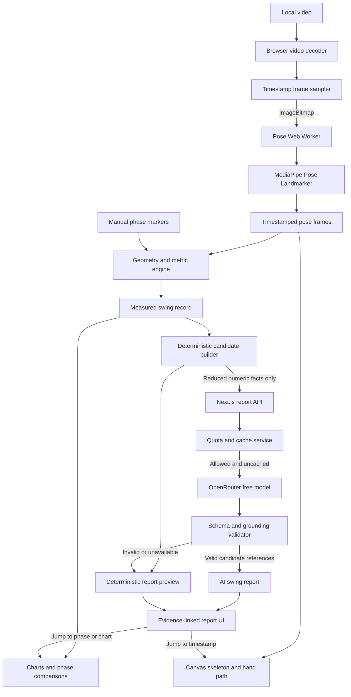

# Golf Swing Analyser — Revised AI-Led MVP Plan

## A. Product overview

Golf Swing Analyser will be an AI-assisted web application that turns a face-on golf-swing video into an understandable, evidence-linked movement report.

The user experience will combine:

- Video playback with a synchronized pose skeleton.
- A hand-path trace and movement charts.
- User-marked address, top, impact, and finish positions.
- Swing tempo and phase timing.
- Body-position and joint measurements.
- A natural-language AI report explaining the most relevant observations, why they may matter, and what the golfer should inspect in the video.
- Links from every AI observation to its supporting phase, chart, or measurement.
- Clear tracking-confidence and single-camera limitations.

The LLM report is a must-have part of the MVP. It will not receive the video and will not independently interpret raw frames. It will explain a constrained set of observations generated from measured pose data.

True clubhead speed remains excluded: MediaPipe tracks 33 body landmarks but no club landmarks, and credible speed measurement requires clubhead tracking, spatial calibration, reliable impact detection, and sufficiently high capture rates. See the [MediaPipe landmark set](https://developers.google.com/edge/mediapipe/solutions/vision/pose_landmarker) and [golf biomechanics measurement review](https://pmc.ncbi.nlm.nih.gov/articles/PMC9227529/).

## B. User-facing output

### Analysis workspace

The user first receives the visual analysis:

- Annotated swing video.
- Timeline and analysed-frame stepping.
- Address, top, impact, and finish markers.
- Hand-path trace, explicitly labelled as hand movement rather than club path.
- Current measurements.
- Selectable charts.
- Tracking-quality indicators.

### Key swing facts

After phase marking, the application derives golfer-facing facts:

- Backswing duration.
- Downswing duration.
- Backswing-to-downswing tempo ratio.
- Lead/trail elbow changes between phases.
- Lead/trail knee-flexion changes.
- Pelvis movement relative to address and stance width.
- Shoulder and hip tilt changes.
- Torso side-bend changes.
- Hand position and path changes in body-relative units.
- Measurements or phases affected by poor landmark visibility.

### AI swing report

The final result is organized around three to five evidence-backed insights rather than a list of angles.

Example:

> **Your swing used a 3.1:1 tempo**
>
> Your backswing took approximately three times as long as the movement from the top to impact. This gives you a repeatable timing baseline for comparing future swings. Tempo alone does not determine swing quality, but large changes between recordings can help identify inconsistency.
>
> Evidence: Address 0.42 s · Top 1.84 s · Impact 2.30 s  
> [View timing chart] [Jump to top]

> **Your pelvis moved toward the trail side during the backswing**
>
> The centre of your hips moved 0.16 stance-widths away from its address position by the top. This may be useful when reviewing how centred your movement appears and how your direction changes during transition.
>
> Evidence: Address → Top · Pelvis movement 0.16 stance-widths  
> [Show pelvis trace] [Compare phases]

> **Impact arm measurements have reduced confidence**
>
> The lead wrist was partially obscured around impact, so the elbow measurement in this section may be less reliable. Review the skeleton overlay before drawing conclusions from it.
>
> [Jump to low-confidence section]

The report may explain why an observable movement is commonly reviewed, but it must not present a definitive diagnosis, causal claim, or personalized coaching prescription.

## C. MVP scope

### Must-have

1. Local upload and validation of a short face-on swing video.
2. Browser-side MediaPipe pose estimation in a worker.
3. Synchronized skeleton and hand-path overlay.
4. Playback, scrubbing, and analysed-frame navigation.
5. Manual address, top, impact, and finish workflow.
6. Tempo, phase-duration, body-position, and joint measurements.
7. Charts and phase-to-phase comparisons.
8. Deterministic candidate-observation generation.
9. OpenRouter-generated evidence-led report.
10. Links from each report observation to supporting UI evidence.
11. Five AI-assisted swing analyses per customer per UTC day.
12. A readable deterministic report when OpenRouter, quota storage, or a free model is unavailable.
13. Responsive design, accessibility, tests, CI, documentation, and deployment.

### Should-have

- Adaptive pose sampling on slower devices.
- Cached AI response for an unchanged analysis.
- Processing and tracking-quality summaries.
- Remaining daily AI-analysis allowance displayed before generation.
- Report feedback buttons: useful/not useful and inaccurate/unclear.
- Lite model fallback.
- A short licensed sample video.

### Could-have

- Export analysis and report as JSON.
- Export a report screenshot.
- Compare two previously exported analyses.
- PWA installation.
- Cloudflare Turnstile if automated API abuse appears during deployment testing.

### Explicitly excluded

- Clubhead speed, club path, face angle, attack angle, ball speed, launch conditions, and shot trajectory.
- Automatic phase detection.
- Definitive fault diagnosis or a swing-quality score.
- Live camera analysis.
- Down-the-line-specific analysis.
- Accounts and long-term cloud storage.
- Raw video or image transmission to OpenRouter.
- Claims of launch-monitor, biomechanics-lab, or professional-coach equivalence.

## D. Technology decision

### Application framework

Use **Next.js App Router with React and TypeScript**.

The original client-only plan favoured Vite. The required LLM feature introduces a protected API key, server-side validation, rate limiting, and OpenRouter calls. Next.js now earns its additional complexity by providing:

- A server-only route handler for report generation.
- Secure environment-variable access.
- Straightforward Vercel deployment.
- Shared TypeScript schemas between client and server.
- Static rendering for the application shell while keeping video processing in a client-only feature.

MediaPipe and browser-video modules must remain inside client components or workers and must never be imported into server execution.

### Final stack

- Next.js and React.
- Strict TypeScript with `noUncheckedIndexedAccess`.
- Tailwind CSS.
- `@mediapipe/tasks-vision`, pinned to an exact stable version.
- Web Worker and transferable `ImageBitmap`.
- Canvas for skeleton and hand-path rendering.
- Recharts for one selectable measurement chart.
- Zod or an equivalent runtime schema library for API boundaries.
- OpenRouter `openrouter/free` route for report generation.
- Managed Redis-compatible storage through a Vercel integration for quotas and cached reports.
- Vitest, Testing Library, and Playwright.
- GitHub Actions.
- Vercel deployment.

### Why `openrouter/free`

OpenRouter currently offers a free-model router that selects an available free model compatible with requested features. Free models are currently capped at 20 requests per minute and 50 per day for an account without purchased credits, rising to 1,000 per day after at least $10 of credits has been purchased. Availability and model selection can change, so no particular free model should be embedded in the application contract. See [OpenRouter free models](https://openrouter.ai/models?fmt=cards&output_modalities=text) and [current rate limits](https://openrouter.ai/pricing).

The request will specify:

- Text-only input.
- Low temperature.
- Short output limit.
- JSON-schema structured output.
- No web search or plugins.
- Data-collection restrictions where the selected free route supports them.

Because free-model capacity is not production-grade, deterministic fallback output is a core feature rather than an edge case.

## E. System architecture



### Privacy boundary

The following remain entirely in the browser:

- Video file.
- Video frames.
- Images.
- Raw MediaPipe landmarks.
- Complete timestamped pose sequence.

Only this reduced information is sent to the server:

- Face-on view identifier.
- Handedness.
- Phase timestamps.
- Approved metric values at marked phases.
- Phase-to-phase changes.
- Tempo and duration values.
- Confidence/missingness summaries.
- Deterministically generated observation candidates.

No filename, free-text user prompt, image, video, or personal identifier is included.

## F. Core data contracts

```ts
type PhaseId = "address" | "top" | "impact" | "finish";

type MetricId =
  | "backswingDuration"
  | "downswingDuration"
  | "tempoRatio"
  | "leadElbowFlexion"
  | "trailElbowFlexion"
  | "leadKneeFlexion"
  | "trailKneeFlexion"
  | "shoulderTilt"
  | "hipTilt"
  | "torsoSideBend"
  | "pelvisShift"
  | "handPosition";

interface PhaseSnapshot {
  phase: PhaseId;
  timestampMs: number;
  metrics: Partial<Record<MetricId, number>>;
  confidence: Partial<Record<MetricId, "high" | "medium" | "low">>;
}

interface AnalysisReportInput {
  schemaVersion: 1;
  view: "face-on";
  handedness: "right" | "left";
  phases: PhaseSnapshot[];
  timing: {
    backswingMs: number;
    downswingMs: number;
    tempoRatio: number;
  };
  quality: {
    usablePoseFramePercent: number;
    lowConfidencePhaseIds: PhaseId[];
    unavailableMetricIds: MetricId[];
  };
}

type CandidateCategory =
  | "tempo"
  | "pelvis-movement"
  | "arm-structure"
  | "lower-body"
  | "body-tilt"
  | "hand-path"
  | "tracking-quality";

interface ObservationCandidate {
  id: string;
  category: CandidateCategory;
  phaseIds: PhaseId[];
  metricIds: MetricId[];
  importance: number;
  evidence: Array<{
    metricId: MetricId;
    phaseId?: PhaseId;
    value: number;
    unit: "degrees" | "milliseconds" | "ratio" | "stance-widths";
  }>;
  approvedContext: string;
}

interface AiInsight {
  candidateId: string;
  title: string;
  explanation: string;
  whyItMayMatter: string;
  reviewAction: string;
}

interface AiSwingReport {
  schemaVersion: 1;
  summary: string;
  insights: AiInsight[];
  limitations: string[];
  generatedBy: "openrouter" | "deterministic";
}
```

The LLM does not generate or modify evidence. It selects candidate IDs and writes explanatory prose around approved candidates. The UI renders measurements from the trusted candidate object, never from numbers written by the model.

## G. Measurement and insight pipeline

### Pose and geometry

- Full MediaPipe model initially, Lite fallback.
- 12 analysed frames per second initially.
- Maximum 240 analysed frames.
- Longest input dimension reduced to 960 px.
- One frame in flight to bound memory.
- Visibility threshold initially 0.6.
- Aspect-correct coordinate calculations.
- Missing data stored as `null`, not interpolated through long gaps.

### Golfer-facing measurements

1. **Tempo**
   - Backswing: address → top.
   - Downswing: top → impact.
   - Ratio: backswing duration / downswing duration.
   - Presented as a repeatability measurement, not a universal target.

2. **Pelvis movement**
   - Hip-midpoint displacement relative to address.
   - Normalize by address stance width where both ankles are reliable.
   - Fall back to shoulder width and label the unit accordingly.

3. **Arm structure**
   - Lead/trail elbow angles at marked phases.
   - Changes between address, top, and impact.

4. **Lower-body movement**
   - Lead/trail knee flexion and phase-to-phase changes.
   - Pelvis location relative to the stance.

5. **Body lines**
   - Shoulder tilt, hip tilt, and torso side-bend in the face-on image plane.
   - Never describe these as full 3D rotation.

6. **Hand path**
   - Trace the midpoint of the two wrists when both are reliable.
   - Normalize positions by body width.
   - Call it hand path, never club path.
   - Do not convert it into clubhead speed.

7. **Tracking quality**
   - Pose availability.
   - Metric-specific confidence.
   - Low-confidence phase warnings.

### Candidate generation

A pure deterministic module produces report candidates such as:

- Tempo fact.
- Largest reliable phase-to-phase metric change.
- Pelvis direction change.
- Lead/trail arm-structure change.
- Knee-flexion change.
- Hand-path movement.
- A tracking limitation that materially affects interpretation.

Candidate ranking rules:

1. Exclude low-confidence facts except as limitation candidates.
2. Prefer facts spanning marked phases.
3. Include tempo when address, top, and impact exist.
4. Select at most one candidate from each category.
5. Select three primary observations plus one quality warning when needed.
6. Never label a candidate good, bad, correct, or faulty.
7. Never compare with a professional or population norm in the MVP.

A small, source-documented knowledge catalogue provides the permitted “why it may matter” context. The LLM may paraphrase this context but cannot introduce a new measurement category.

## H. LLM integration and safeguards

### Report-generation flow

1. Require address, top, and impact markers; finish is recommended but optional.
2. Build and display the deterministic facts before generation.
3. Obtain explicit consent to send the reduced numeric summary.
4. POST the validated `AnalysisReportInput` to `/api/reports`.
5. Rebuild candidates on the server using the shared pure module.
6. Check the response cache using a SHA-256 hash of the canonical reduced input.
7. Enforce customer and global quotas.
8. Call `openrouter/free` using the server-only API key.
9. Validate JSON shape and candidate references.
10. Render the AI prose with evidence from trusted candidates.
11. Fall back to the deterministic report on timeout, invalid output, quota exhaustion, or model unavailability.

### Grounding constraints

The system prompt will require the model to:

- Use only supplied candidates.
- Explain rather than diagnose.
- Use conditional language such as “may be useful to review”.
- Avoid declaring a movement correct or incorrect.
- Avoid medical, injury, or performance claims.
- Avoid mentioning clubhead speed, ball flight, or unmeasured club properties.
- Avoid inventing numerical values.
- Avoid giving drills or swing-change instructions.
- State confidence limitations prominently.

Server validation will reject a response when:

- It references an unknown candidate.
- It includes duplicate or excessive insights.
- Required fields are missing.
- It contains numerical claims in generated prose.
- It mentions an excluded metric.
- It exceeds field-length limits.
- It contains markup or URLs.
- It fails runtime schema validation.

AI text is rendered as plain text, never injected HTML.

### Quotas

- Five unique AI-assisted swing analyses per customer per UTC day.
- Global application limit of 45 OpenRouter requests per UTC day, retaining five of the current 50-request free allowance for testing and operational margin.
- Under the current 50-request free allowance, the protected public quota supports approximately nine customers using their full five-analysis allowance each day.
- Cache hits do not consume a customer or global model-request allowance.
- An unchanged analysis returns the cached report.
- Local pose processing and deterministic reporting remain available after the AI quota is reached.
- If at least $10 of OpenRouter credits is later purchased and the account allowance rises to 1,000 requests per day, the global application limit may be increased through configuration without changing code.

Customer identity for the account-free MVP:

- Derive a daily identifier using an HMAC of date plus request IP.
- Store no raw IP address.
- Expire counters after no more than 48 hours.
- Explain that shared networks may share an allowance.
- Store the daily global counter and report cache in Redis-compatible managed storage.

The API key is server-only and must never use a `NEXT_PUBLIC_` environment-variable prefix.

### Privacy

Before generation, show:

> Your video stays on this device. To generate the written report, the application sends a reduced set of anonymous movement measurements and confidence information to an external language-model provider. No video frames or raw landmarks are sent.

OpenRouter forwards inputs to model providers with differing retention policies, so the privacy notice and chosen routing settings must reflect the actual deployment. See the [OpenRouter privacy policy](https://openrouter.ai/privacy/).

## I. UI/UX specification

### Workflow

1. **Upload**
   - Select video.
   - Select handedness.
   - Review recording guidance and privacy.

2. **Process**
   - Model-loading and pose-analysis progress.
   - Cancel and retry controls.
   - No AI request occurs yet.

3. **Review tracking**
   - Play the annotated video.
   - Inspect confidence and hand path.
   - Replace the video if pose quality is inadequate.

4. **Mark key moments**
   - Guided four-step phase-marking mode.
   - Large player and fine analysed-frame controls.
   - Address → top → impact → finish.
   - Permit revisiting earlier markers.
   - Explain that phase timing depends on the chosen frames.

5. **Explore measurements**
   - Key facts and selectable chart.
   - Phase comparison cards.
   - Plain-language metric definitions.

6. **Generate AI report**
   - Show which reduced data will be sent.
   - Show the remaining allowance from the customer’s five daily AI analyses.
   - Generate once markers are confirmed.
   - Display loading, fallback, quota, and retry states.

7. **Read and inspect**
   - Summary followed by evidence-linked insights.
   - Each insight has:
     - Observation.
     - Why it may matter.
     - What to inspect next.
     - Supporting metrics.
     - Jump-to-phase/chart controls.
     - Confidence label.
   - Permanent “What this analysis cannot measure” disclosure.

### Responsive behaviour

Desktop:

- Video and report visible in a two-column layout after report generation.
- Chart and phase comparison below.

Mobile:

- Video first.
- Report cards below.
- Evidence links scroll back to the relevant video/chart position.
- Phase controls use large touch targets.
- Do not attempt simultaneous video/chart/report columns.

## J. Testing and quality strategy

### Domain tests

- Geometry at known angles.
- Aspect-ratio correction.
- Tempo calculations.
- Phase ordering.
- Stance- and shoulder-width normalization.
- Hand-path calculation.
- Confidence filtering.
- Candidate ranking and exclusion.
- Deterministic report generation.
- Identical canonical inputs produce identical hashes.

### API tests

- Valid report request.
- Missing/invalid phases.
- Out-of-range values.
- Oversized payload.
- Unknown metrics.
- Five successful analyses followed by a rejected sixth analysis for the same customer/day.
- Independent quota counters for different customers.
- Global quota exceeded.
- Cache hit does not consume one of the five analyses.
- OpenRouter timeout/429/invalid JSON.
- Unknown candidate returned.
- Excluded metric in prose.
- Numerical hallucination in prose.
- Deterministic fallback.
- No API key or server secret included in client bundles.

Use a storage interface with an in-memory test adapter and Redis production adapter.

### LLM evaluation set

Create at least 12 fixed structured analysis fixtures:

- Balanced high-confidence sequence.
- Large phase-to-phase pelvis movement.
- Marked elbow changes.
- Marked knee changes.
- Unusual tempo without labelling it bad.
- Missing finish phase.
- Low-confidence impact.
- Missing wrist data.
- Left-handed mapping.
- Minimal valid input.
- Multiple equally ranked candidates.
- Adversarial/out-of-range payload.

Evaluate responses against a rubric:

- Every insight maps to supplied evidence.
- No unsupported number.
- No club or ball claim.
- No definitive diagnosis.
- Explanation is understandable to a golfer.
- “Why it may matter” remains conditional.
- Review action points back to an available visualization.
- Confidence limitations are not minimized.

Run schema and grounding checks automatically. Review a small sample manually before release because prose usefulness cannot be established through schema tests alone.

### E2E tests

Mocked critical journey:

- Upload → process → inspect → mark phases → view facts → consent → generate report → follow evidence link.

Additional cases:

- Five analyses permitted and sixth analysis quota blocked.
- Global OpenRouter allowance exhausted.
- OpenRouter unavailable.
- Invalid model response.
- Cached report.
- Low-confidence analysis.
- Mobile viewport.
- Keyboard-only operation.

Real OpenRouter calls should not run on every CI build. Provide a manually triggered smoke workflow using a restricted deployment secret.

### CI

For every pull request and `main` push:

1. Install locked dependencies.
2. Format check.
3. ESLint.
4. Type check.
5. Unit/component tests and coverage.
6. Production build.
7. Verify model/WASM assets.
8. Playwright tests.
9. Secret/client-bundle check.
10. Upload reports on failure.

## K. Revised seven-day roadmap

### Day 1 — Prove both external dependencies

- Initialize Next.js, strict TypeScript, Tailwind, tests, and Git.
- Prove MediaPipe worker inference on a real swing.
- Prove one protected Next.js route can call `openrouter/free` with a fixed structured measurement payload.
- Confirm structured-output behaviour and deterministic fallback.
- Deploy a preview immediately.
- Benchmark Full and Lite.

**Done:** Real landmarks are obtained, one grounded sample report is generated, secrets remain server-side, and preview deployment works.

### Day 2 — Production pose pipeline

- Video validation and metadata.
- Frame sampler and worker protocol.
- Progress, cancellation, retry, and cleanup.
- Typed application state.
- Skeleton and hand-path data.

**Done:** A supported video reliably becomes a bounded, timestamped pose sequence.

### Day 3 — Player, phases, and measurements

- Synchronized video/canvas player.
- Scrubbing and analysed-frame navigation.
- Guided phase-marker workflow.
- Tempo, joint, pelvis, body-line, and hand-path calculations.
- Unit tests for all mathematics.

**Done:** Users can inspect a swing and produce a complete measured swing record.

### Day 4 — Grounded AI report pipeline

- Shared report schemas.
- Deterministic candidate builder and knowledge catalogue.
- Deterministic fallback writer.
- OpenRouter prompt and output schema.
- Response grounding validator.
- Evidence-link model.
- Initial LLM evaluation fixtures.

**Done:** AI output can only select validated candidates, and every insight links to trusted evidence.

### Day 5 — Quotas and polished product experience

- Redis-compatible quota/cache integration.
- Five-per-customer and 45-global daily limits.
- Consent and privacy UI.
- Full report interface.
- Responsive design and accessibility.
- Useful/not-useful feedback stored locally or emitted without personal content.

**Done:** The complete golfer-facing journey works on desktop and mobile layouts.

### Day 6 — Compatibility, security, and evaluation

- Playwright journeys.
- Browser/device matrix.
- API abuse and validation tests.
- OpenRouter failure tests.
- Manual review of fixture reports.
- Performance and memory profiling.
- Remove or rewrite any insight pattern that overreaches.

**Done:** CI is green and known limitations are documented.

### Day 7 — Release and portfolio packaging

- Production deployment.
- README, ADRs, privacy explanation, architecture, and test matrix.
- Demo video/GIF.
- Record real processing, pose-availability, quota, test, and bundle metrics.
- Verify no video/frame network transmission.
- Tag `v0.1.0`.

**Done:** A fresh clone is reproducible and the public demo remains useful even when free AI capacity is unavailable.

## L. Risk register

| Risk | Mitigation | Contingency |
|---|---|---|
| LLM invents advice or measurements | Candidate-only input, schema validation, no numbers in prose, evidence rendered separately | Reject output and use deterministic report |
| Free model quality varies | Low-temperature structured request, strict validator, evaluation fixtures | Deterministic fallback |
| Free OpenRouter capacity is exhausted | Five customer analyses/day, 45 global requests/day, response caching | Continue local analysis and fallback report |
| A small number of customers consumes the daily allowance | Global quota, visible remaining allowance, cache identical analyses | Reduce configurable per-customer quota without code changes if necessary |
| API endpoint is abused | Server validation, small body limit, IP-HMAC quota, global quota | Add Turnstile or restrict live AI to demo access |
| OpenRouter privacy varies by provider | Send no media/raw landmarks; explicit consent; use available privacy controls | Disable AI while retaining local report |
| Next.js complicates browser-only MediaPipe | Isolate analysis behind client boundary and prove worker build on Day 1 | Reassess Vite plus minimal server only if spike fails |
| Measurements are not golfer-friendly | Tempo, phase comparison, hand path, narrative report, evidence links | Remove metrics users cannot understand or act on |
| AI sounds like validated coaching | Evidence-led wording, prohibited-claim validation, visible limitations | Narrow output to descriptive explanation |
| Clubhead-speed expectation | Explicit capability statement and separate future roadmap | Do not provide a proxy labelled as club speed |
| Phase marking is tedious | Guided step-by-step workflow and fine navigation | Permit three required phases; finish optional |
| Pose fails around impact | Confidence-specific gaps and warnings | Omit affected candidate from report |
| One-week scope expands | Feature freeze after Day 5 | Drop export, feedback, sample video, and extra visual polish first |

## M. Definition of done

- [ ] A golfer can upload and locally process a supported face-on swing.
- [ ] The player shows synchronized pose and hand-path overlays.
- [ ] Address, top, and impact are required and easy to mark; finish is supported.
- [ ] Tempo and approved pose-derived measurements are correct and tested.
- [ ] Raw video, images, and landmarks never leave the browser.
- [ ] The AI receives only a reduced validated measurement record.
- [ ] Every AI insight references a valid deterministic candidate.
- [ ] Supporting evidence is rendered from trusted application data.
- [ ] Invalid, unsafe, unavailable, or quota-limited AI output falls back cleanly.
- [ ] Five AI-assisted swing analyses are permitted per customer per UTC day and the sixth is rejected cleanly.
- [ ] The 45-request global reserve limit works and resets correctly.
- [ ] OpenRouter credentials exist only on the server.
- [ ] Clubhead speed and other unsupported club/ball metrics are never reported.
- [ ] CI passes linting, type checks, tests, E2E, and production build.
- [ ] Desktop and mobile critical journeys are accessible.
- [ ] Production deployment and privacy behaviour are manually verified.
- [ ] README and demo explain both the value and limitations honestly.

## Post-MVP priorities

1. Compare two swings using the same evidence-led report structure.
2. Add down-the-line capture mode with separately validated measurements.
3. Develop automatic phase suggestions with manual confirmation.
4. Evaluate a dedicated golf-club keypoint model using high-frame-rate footage.
5. Investigate calibrated clubhead speed only after reliable club tracking exists.
6. Add user accounts and stored analysis history if recurring use justifies a backend.
7. Validate coaching rules with qualified golf professionals before offering prescriptive recommendations.
